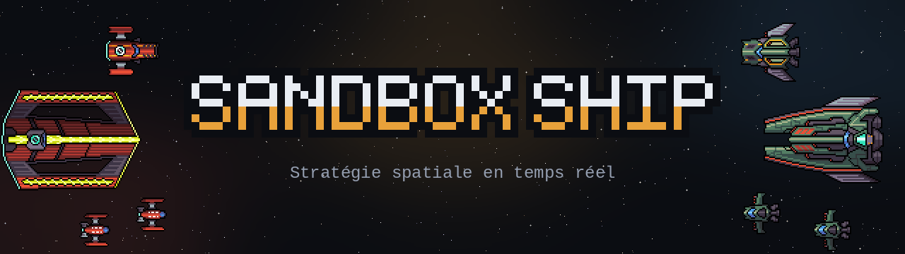
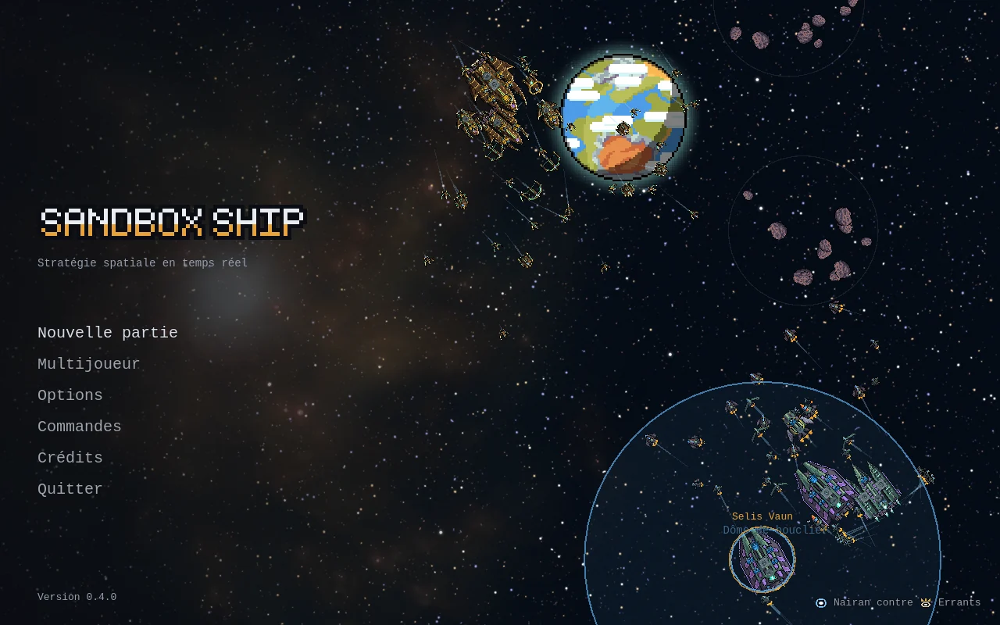
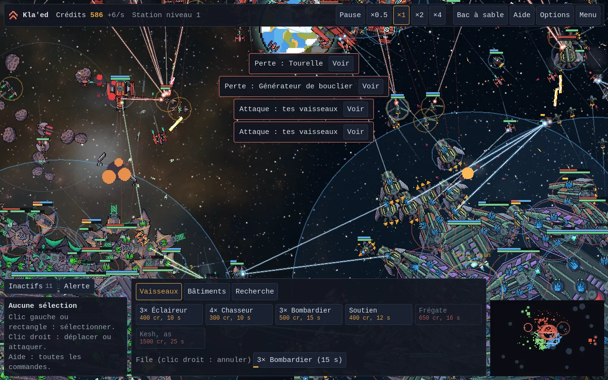
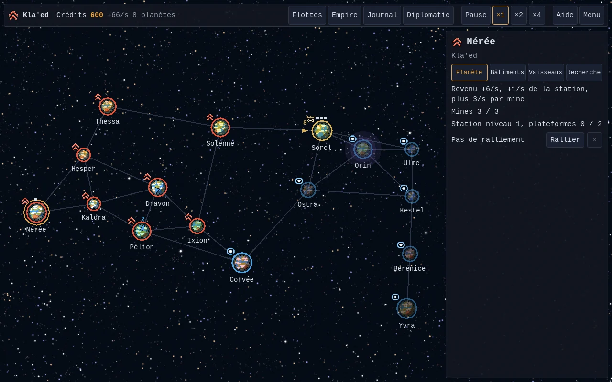
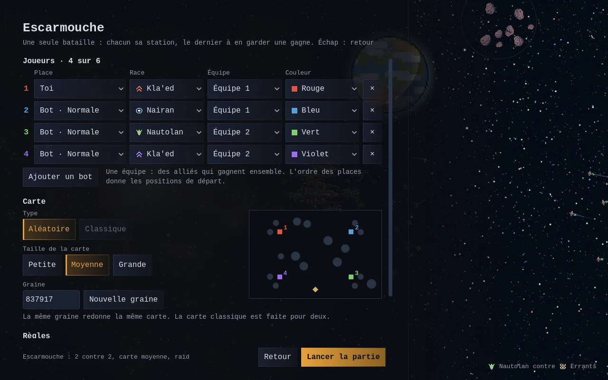

<p align="center">
  
</p>

<p align="center">English · <a href="README.md">Français</a></p>

**Sandbox Ship** is a real-time space strategy game in pixel art. Build a station, defend it,
launch fleets and conquer a galaxy planet by planet, alone against the AI or with up to six
players over the network, in teams.

**[Download the latest version](../../releases/latest)** for Linux or Windows.

| | |
|---|---|
|  |  |
|  |  |

The screenshots show the game in French; it plays in English too (Options, Language).

## The game

- **Galactic campaign**: planets linked by lanes, on a small, medium or large galaxy. Income,
  stations, mines and platforms, research in tiers, truces between sides, fleets intercepting
  each other on the lanes. Each encounter is commanded as a battle or resolves on its own.
- **Skirmish**, and its variants: Survival (waves of Errants), Zone control (beacons to hold),
  Assault (a fortress to take in time), Regicide (each side has its flagship).
- **Sandbox**: AI off, plenty of credits, place what you want where you want.
- **Three playable races**, each with its trait and three heroes: the Kla'ed (weapons +15%), the
  Nairan (shields +40%), the Nautolan (regenerating hulls). The Errants, neutral, guard the raid
  sites.
- **Thirteen ship classes**, from the scout to the Colossus. The big ones have destructible
  parts: turrets, engines, shield generators, hangars. Bullets, lasers, torpedoes, rays,
  continuous beams, bursts that reload, missile swarms and ion cannons; flak shoots missiles down
  in flight. In the endgame, the Star lance strikes anywhere on the map.
- **An AI** that adapts to what it sees, and ships that pick their targets, keep their distance,
  dodge announced strikes and fall back to get repaired.
- **Over the network**, up to six players, campaign included: on the local network (games show
  up by themselves), through the online server (nothing to open at home) or on a dedicated
  server.
- **In French or in English**, as chosen in the options.

## Playing

Every version's archives are on the [Releases](../../releases) page. The `main-build` and
`dev-build` pre-releases carry the latest state of each branch, rebuilt on every push. Keep the
executable and its `data_Game_*` folder side by side.

- **Linux**: extract the archive, then run `./SandboxShip.x86_64`.
- **Windows**: extract the zip, then run `SandboxShip.exe`. The executable is not signed: if
  Windows shows "Windows protected your PC", choose "More info", then "Run anyway".

The main battle controls; all of them are in the game, "Controls" menu:

| Key | Effect |
|---|---|
| Left click, drag | Select |
| Right click | Move, or attack the target under the pointer |
| F then click | Attack-move: engages everything on the way |
| E | Ability of the selected ships |
| P | Fly the selected ship |
| Ctrl + 1 to 9, then 1 to 9 | Create a group, then recall it |
| WASD or arrows, wheel | Move the view, zoom |
| Space | Pause |

Keys can be changed in the "Controls" screen.

## Building

You need the .NET 10 SDK and Godot 4.7.2 .NET, with its export templates to export.

```bash
dotnet test godot/Sim.Tests       # the simulation's tests, without Godot
godot --path godot/Game           # runs the game
godot -e --path godot/Game        # opens the editor

cd godot/Game                     # exports
mkdir -p ../build/linux ../build/windows
godot --headless --export-release "Linux" ../build/linux/SandboxShip.x86_64
godot --headless --export-release "Windows" ../build/windows/SandboxShip.exe
```

The code and its documentation are in French. Launch options, network play and servers are
described in [godot/README.md](godot/README.md); progress and the rules of this version, in
[godot/PLAN.md](godot/PLAN.md).

## Translation

The code writes French; the English is in [godot/Game/lang/en.po](godot/Game/lang/en.po), keyed
by the French text, with `{0}`, `{1}`... for the values of composed texts. The game translates
what it shows as it shows it ([godot/Game/scripts/Core/Lang.cs](godot/Game/scripts/Core/Lang.cs)).

```bash
python3 godot/tools/lang.py --check     # texts of the code without English
python3 godot/tools/lang.py --add       # adds them to en.po, to translate
godot/tools/lang-check.sh "godot --path godot/Game" missing.txt   # texts shown in play without English
```

## Continuous integration and releases

The GitHub CI ([.github/workflows/build.yml](.github/workflows/build.yml)) runs the tests, then
the Linux and Windows exports, on every push to `main` or `dev` and on every pull request, and
keeps the archives in the run. It then publishes them:

- a push to `main` or `dev` rebuilds that branch's pre-release (`main-build`, `dev-build`), whose
  archives keep the same names, so the same download addresses;
- a `vX.Y.Z` tag publishes the version's release, once the game carries that number;
- a pull request publishes nothing.

Before anything is published, both exports are started without a window, each on its own
system: a battle and the campaign must run a few hundred frames and stop by themselves. A
version also goes to itch.io when the repository names the game in the `ITCH_GAME` variable and
butler's key is in the `BUTLER_API_KEY` secret.

## The repository

- `godot/`: the game, in Godot 4.7 and C#.
  - `Sim/`: the simulation, in plain C#, deterministic, with a fixed step.
  - `Sim.Tests/`: its tests (xUnit).
  - `Game/`: the Godot project, with rendering, interface and network.
- `src/` and `tests/`: the [web version](docs/version-web.md), in TypeScript and Phaser, frozen;
  it is the reference of the simulation's tests.
- `docs/`: this README's images and the web version's documentation.

## Credits and license

Sprites: the Void packs by Foozle and Space Breaker by zintoki, under CC0. Godot Engine logo:
Andrea Calabró, under CC BY 4.0. The details are in [CREDITS.md](CREDITS.md).

The game's code is under the [MIT](LICENSE) license. The works above keep their own.
