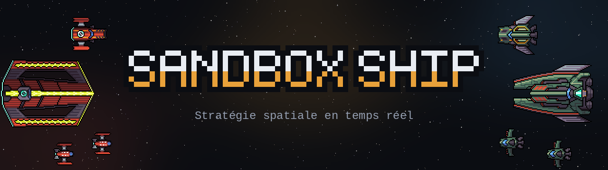
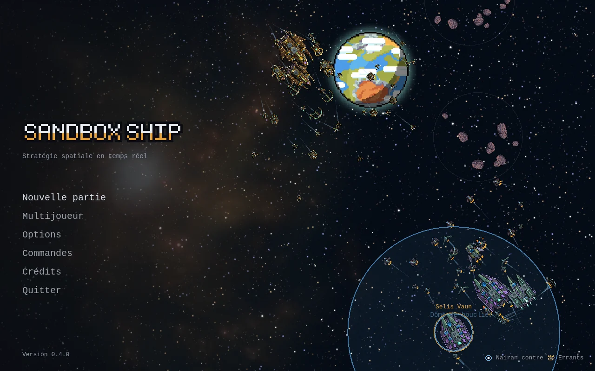
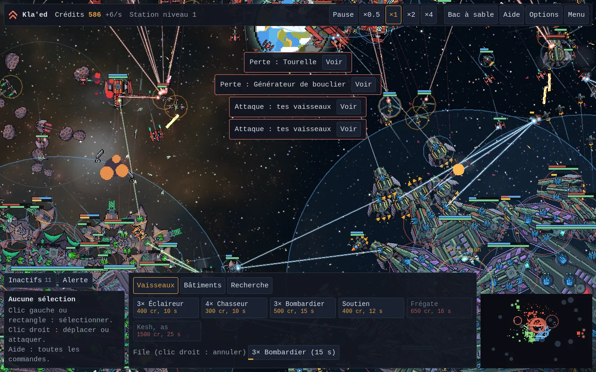
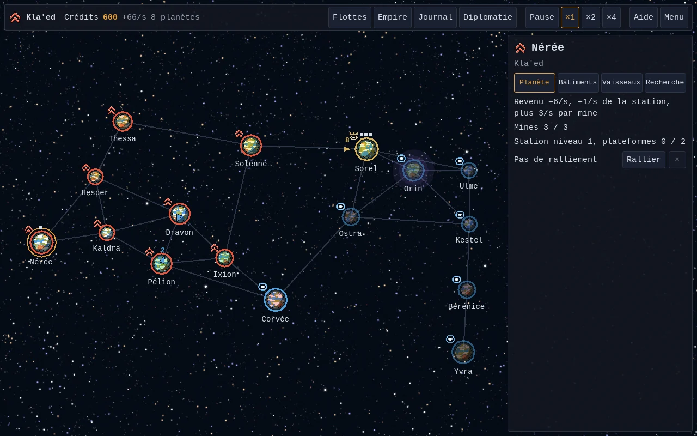
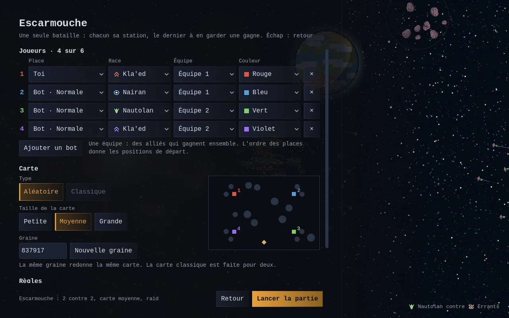

<p align="center">
  
</p>

**Sandbox Ship** est un jeu de stratégie spatiale en temps réel, en pixel art. On bâtit une
station, on la défend, on lance des flottes et on conquiert une galaxie planète après planète,
seul contre l'IA ou jusqu'à six joueurs en réseau, par équipes.

**[Télécharger la dernière version](../../releases/latest)** pour Linux ou Windows.

| | |
|---|---|
|  |  |
|  |  |

## Le jeu

- **Campagne galactique** : des planètes reliées par des routes, sur une galaxie petite, moyenne
  ou grande. Revenus, stations, mines et plateformes, recherche par paliers, trêves entre
  camps, flottes qui s'interceptent sur les routes. Chaque rencontre se commande en bataille ou
  se résout seule.
- **Escarmouche**, et ses variantes : Survie (des vagues d'Errants), Contrôle de zone (des
  balises à tenir), Assaut (une forteresse à prendre à temps), Régicide (chacun son vaisseau
  amiral).
- **Bac à sable** : IA coupée, crédits en abondance, on pose ce qu'on veut où on veut.
- **Trois races** jouables, chacune avec son trait et trois héros : les Kla'ed (armes +10 %),
  les Nairan (boucliers +40 %), les Nautolan (coques qui se régénèrent). Les Errants, neutres,
  gardent les sites de raid.
- **Treize classes de vaisseaux**, de l'éclaireur au Colosse. Les gros ont des pièces
  destructibles : tourelles, réacteurs, générateurs de bouclier, hangars. Balles, lasers,
  torpilles, rayons, faisceaux continus, rafales à recharge, essaims de missiles et canons à
  ions ; la flak abat les missiles en vol. En fin de partie, la Lance stellaire frappe n'importe
  où sur la carte.
- **Une IA** qui s'adapte à ce qu'elle voit, et des vaisseaux qui choisissent leurs cibles,
  tiennent leurs distances, esquivent les frappes annoncées et se replient pour se faire réparer.
- **En réseau**, jusqu'à six joueurs, campagne comprise : en réseau local (les parties
  s'affichent d'elles-mêmes), par le serveur en ligne (rien à ouvrir chez soi) ou sur un
  serveur dédié.

## Jouer

Les archives de chaque version sont sur la page [Releases](../../releases). L'exécutable et son
dossier `data_Game_*` restent côte à côte.

- **Linux** : extraire l'archive, puis lancer `./SandboxShip.x86_64`.
- **Windows** : extraire le zip, puis lancer `SandboxShip.exe`. L'exécutable n'est pas signé :
  si Windows affiche « Windows a protégé votre ordinateur », choisir « Informations
  complémentaires », puis « Exécuter quand même ».

Les commandes principales en bataille ; toutes sont dans le jeu, menu « Commandes » :

| Touche | Effet |
|---|---|
| Clic gauche, glisser | Sélectionner |
| Clic droit | Déplacer, ou attaquer la cible visée |
| F puis clic | Attaque-mouvement : engage tout ce qui croise la route |
| E | Capacité des vaisseaux sélectionnés |
| P | Piloter le vaisseau sélectionné |
| Ctrl + 1 à 9, puis 1 à 9 | Créer un groupe, puis le rappeler |
| ZQSD ou flèches, molette | Déplacer la vue, zoomer |
| Espace | Pause |

## Compiler

Il faut le SDK .NET 10 et Godot 4.7.2 .NET, avec ses modèles d'export pour exporter.

```bash
dotnet test godot/Sim.Tests       # tests de la simulation, sans Godot
godot --path godot/Game           # lance le jeu
godot -e --path godot/Game        # ouvre l'éditeur

cd godot/Game                     # exports
mkdir -p ../build/linux ../build/windows
godot --headless --export-release "Linux" ../build/linux/SandboxShip.x86_64
godot --headless --export-release "Windows" ../build/windows/SandboxShip.exe
```

Les options de lancement, le jeu en réseau et les serveurs sont décrits dans
[godot/README.md](godot/README.md) ; l'avancement et les règles propres à cette version, dans
[godot/PLAN.md](godot/PLAN.md).

## Intégration continue et versions

La CI GitHub ([.github/workflows/build.yml](.github/workflows/build.yml)) lance les tests, puis
les exports Linux et Windows, à chaque push sur `main` ou `dev` et à chaque pull request ; les
archives restent attachées au run. Un tag `vX.Y.Z` publie en plus une release avec les deux
archives, après avoir vérifié que le jeu porte bien ce numéro.

`dev` reçoit le travail en cours, `main` les versions publiées. Pour publier une version :

1. Sur `dev`, mettre le numéro dans `godot/Game/project.godot` (`config/version`),
   `godot/Game/scripts/Ui/Menu.cs` (`Version`) et `godot/Game/export_presets.cfg`
   (`file_version` et `product_version`, avec un `.0` de plus), puis commiter.
2. Avancer `main` sur `dev`, poser le tag et pousser :

```bash
git push . dev:main
git tag v0.5.0 main
git push origin main dev v0.5.0
```

## Le dépôt

- `godot/` : le jeu, en Godot 4.7 et C#.
  - `Sim/` : la simulation, en C# pur, déterministe et à pas fixe.
  - `Sim.Tests/` : ses tests (xUnit).
  - `Game/` : le projet Godot, avec le rendu, l'interface et le réseau.
- `src/` et `tests/` : la [version web](docs/version-web.md), en TypeScript et Phaser, gelée ;
  elle sert de référence aux tests de la simulation.
- `docs/` : les images de ce README et la documentation de la version web.

## Crédits

Sprites : les packs Void de Foozle et Space Breaker de zintoki, en CC0. Logo de Godot Engine :
Andrea Calabró, en CC BY 4.0. Le détail est dans [CREDITS.md](CREDITS.md).
